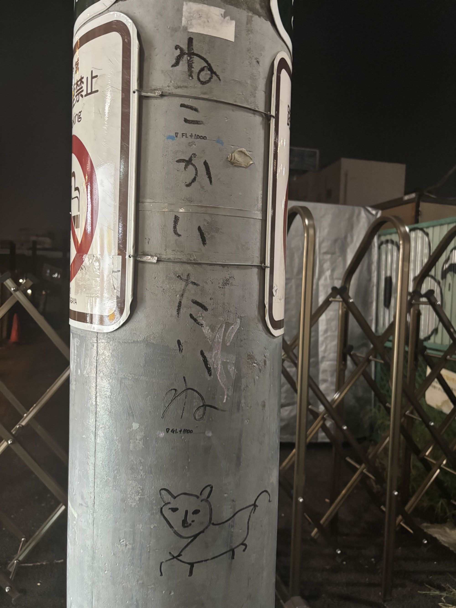
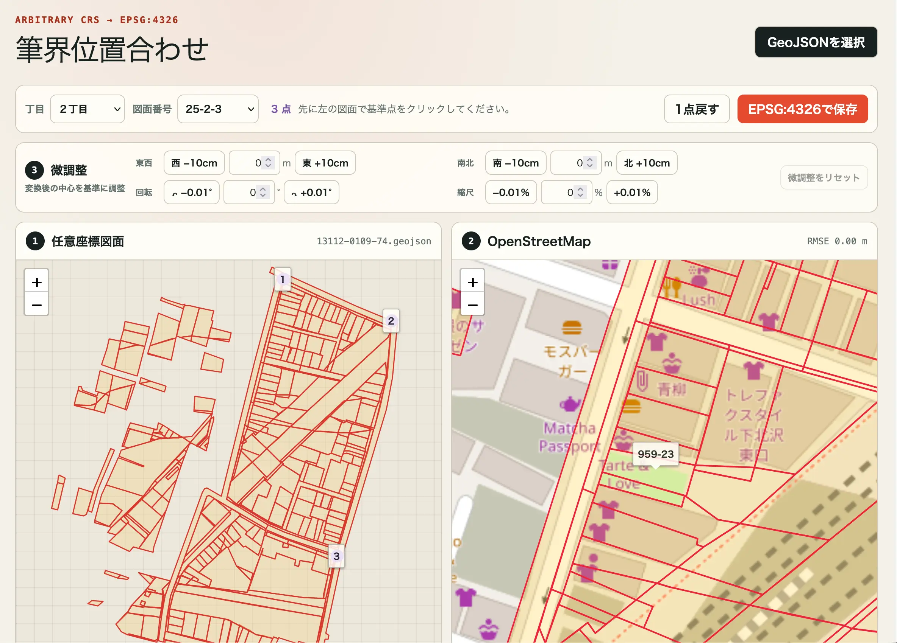
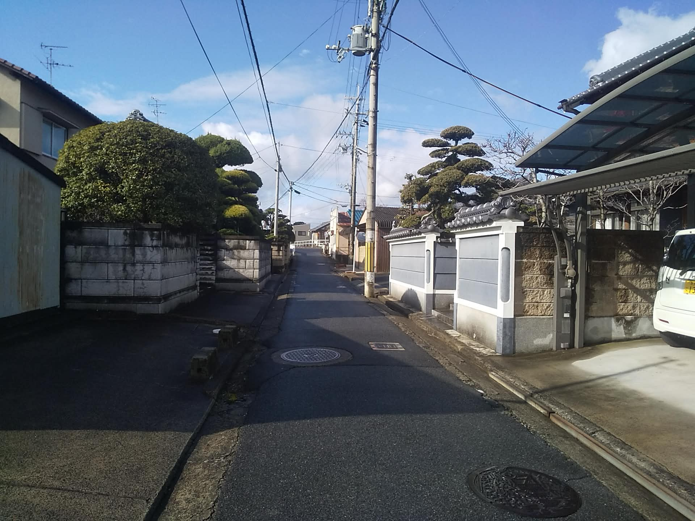
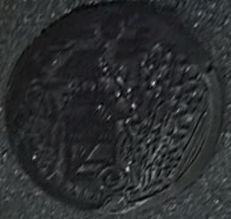
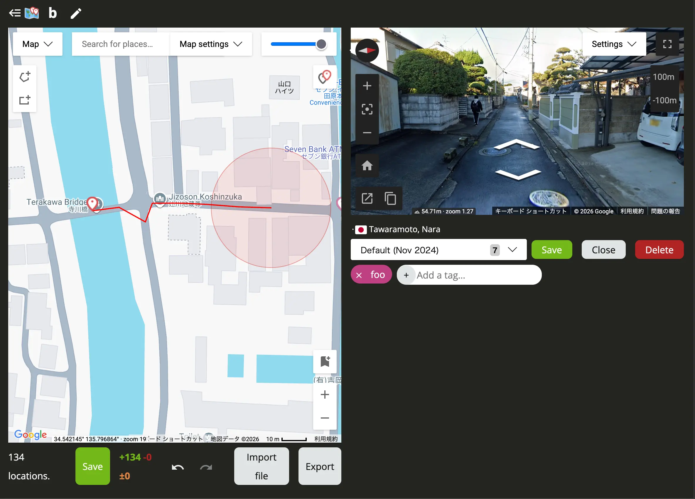

# DIVER OSINT CTF 2026 Writeup (Wani Hackase)

DIVER OSINT CTF 2026にチームWani Hackaseで参加し、4位を獲得しました。私が主に取り組んだ問題の解法をまとめます。

https://x.com/DIVER_OSINT_CTF/status/2081236723661787154

## [introduction] excited

> 動画 / Video: https://www.youtube.com/shorts/PN3b2e3iJdo
>
> この動画で「興奮している」と語っている男性が立っている場所を示せ。  
> 座標はGoogle Mapsの衛星画像表示に準拠する。

リンク先はショート動画です。フル版のインタビューに映っている背景の建物から場所を特定できます。

https://www.youtube.com/watch?v=w5PnoRN0l3E

## [geo] kaitai1

> この電柱の、すぐ奥に見えている土地の 地番 を 半角数字 で答えよ。  
> なお、住居表示 の実施状況にかかわらず 地番 で解答せよ。  
> 例えば、`東京都新宿区西新宿二丁目318-18` の場合、Flag は `Diver26{318-18}` となる。
>
> 

路上喫煙禁止の看板の下部に「…GAYA」と書かれています。世田谷区ではないかと推測し「世田谷 禁煙」で検索すると、同じ看板の画像が見つかります。

また、画像をGoogle Lensで検索すると、SNS上に同じ被写体の投稿が数件が見つかります。そのうちXの投稿への反応から、この電柱は下北沢にあることがわかります。また、別の角度から撮られた写真を見ると、背景に「パチンコ ミナミ」の看板があることがわかります。

Google Earthでパチンコ ミナミの看板を探し、その周辺の建物の形状を比較することで、電柱の位置が[35.662699, 139.668414](https://www.google.com/maps?q=35.662699,139.668414)だと特定できます。土地の住所（住居表示）は東京都世田谷区北沢2丁目32-5です。

この問題では座標を特定するだけでなく、地番を求める必要があります。インターネットで地番を調べられるサービスとして、[MAPPLE法務局地図ビューア](https://labs.mapple.com/mapplexml.html)が有名です。

しかし、このツールで確認できる世田谷区北沢2丁目の地番図は任意座標系となっています。つまり、地番図と実際の地図を自身で正確に重ね合わせる必要があります（ジオリファレンス）。今回はCodexに位置合わせツールを作らせて地番を特定しました。

<small>出典：登記所備付地図データ 世田谷区（法務省）、© OpenStreetMap</small>

フラグは`Diver26{959-23}`です。

## [geo] kaitai2

> kaitai1 の土地は、ある建物が解体され、更地になっているようだ。この解体はある計画に起因すると推定される。  
> その計画が完了した時、この場所に建設される物は何だろうか。  
> その事物を示す Wikidata IDを答えよ。例えば、`Q57965` が答えの場合、Flagは `Diver26{Q57965}` となる。
> 
> - 可能な限り具体的な事物を示せ。例えば、「東京スカイツリー」が答えであるとき、「建物」「塔」「電波塔」などは答えとして認められない。
> - 競技開始後に作成されたIDは解答にならない。

Codexに調べさせたところ、都市計画道路補助第54号線に関連している可能性が高いことがわかりました。

世田谷区が公開している[「補助54号線・世区街10号線 ニュース No.8」](https://www.city.setagaya.lg.jp/01205/4565.html)に掲載された地図を見ると、確かにこの土地に「幹線街路補助線街路第54号線」が作られる予定になっています。

この道路にはWikipediaのページがあり、Wikidata IDはQ11525315です。フラグは`Diver26{Q11525315}`です。

## [geo] kaitai3

> kaitai1 の土地に、昭和後期に存在していた店舗の名前を日本語で答えよ。
> 店名のみ を答えよ。例えば 「株式会社万世」が運営する `肉の万世 秋葉原本店` が存在していた場合、Flagは `Diver26{肉の万世}` となる。

唯一解けなかった問題です。終了後にいくつかWriteupを読みましたが、確信を持って答えに辿り着けそうな資料はまだ見つけられていません。正攻法が気になります。

## [geo] houses

> この写真の撮影地はどこか。地図上で示せ。
>
> 

GeoGuessrの攻略サイトを確認すると、電柱の変圧器やプレートの形から関西地方であることがわかります。

マンホールを画像から切り出し、正面から見た形に変形して回転します。

左側に櫓かロープウェイのような構造物、右側に木のような植物が描かれています。AIに聞くなどして当たりをつけて探すと、田原本町のマンホールであることがわかりました。

https://rojonomanhole.web.fc2.com/nara/tawaramoto_town.htm

影やテレビアンテナの向きから、この画像は西方向を向いて撮影されたと推定できます。また、写真の奥を見ると橋の欄干のようなものが見えます。

そこで、田原本町にある橋をストリートビューで開き、橋の東側の道路を全て確認します。OpenStreetMapから田原本町の橋を134件抽出し、座標を[Map Making App](https://map-making.app/)に読み込ませることで作業を効率化しました。橋の抽出やデータ形式の変換作業はCodexに任せました。

答えは[34.542608, 135.796604](https://www.google.com/maps?q=34.542608,135.796604)です。

## [transportation] telelens

> 映像 / Video: https://youtu.be/3O09qFWkjBs
>
> この動画が撮影された日はいつか。現地時間のYYYY-MM-DDで答えよ。例えば、現地時間で2026年7月1日に撮影された場合、Flagは `Diver26{2026-07-01}` となる。

動画の0:13付近に、日本では見慣れないペイントの機体が写っています。画像検索により、これがニューギニア航空の独立50周年記念塗装機P2-PGAであることがわかります。2026年2月9日から12日まで来日し羽田空港に駐機していたようです。

インターネット上に投稿された写真から、映像のように曇っており地面が濡れているのは2026年2月11日であることがわかります。

フラグは`Diver26{2026-02-11}`です。

## [transportation] air2air2

> 動画 / Video: https://www.youtube.com/watch?v=Mm3CgN6mbVU
>
> この動画は現地時間の2026年1月9日に撮影された。  
> この動画に映っている航空機の機体記号（登録番号）と、コールサインは何か。アンダースコア (`_`) で繋いで解答せよ。  
> たとえば、機体記号が F-WWJJ で、コールサインが AIB789 のとき、Flagは `Diver26{F-WWJJ_AIB789}` となる。  
> 注意:撮影者が搭乗している機体ではない。また、コールサインはICAOコードを使用すること。

動画の冒頭にSafety Instructionsカードの一部が映っています。描かれた垂直尾翼のデザインから、撮影者が搭乗しているのはAirJapanの機体であるとわかります。

また、外の景色を見ると撮影場所は日本のように見えます。日本国内で2機が同時に着陸できるオープンパラレルの平行滑走路があり、かつその着陸ルートに木々が生い茂っている空港は新千歳空港と成田空港だけです。撮影日が1月であるのに雪が見えないことから、これは成田空港への着陸ルートだと推定できます。

2026年1月9日に成田空港へAirJapan機が着陸した際の航跡をFlightRader24やADS-B Exchangeで確認することで、動画に映っているのがACA9便 C-FIVWであることがわかります。フラグは`Diver26{C-FIVW_ACA9}`です。

## 感想

以下の問題は、Codex (GPT-5.6 Sol)に問題文を与えただけで追加の指示をほとんど出さずにフラグを導き出してくれました。

- [geo] F3
- [geo] sprej
- [geo] evacuation
- [geo] stargazing
- [geo] elevation
- [recon] shopping1 / shopping2
- [history] 39
- [history] accident
- [history] tuition
- [company] cooking
- [misc] nui
- [misc] buyout
- [misc] paint
- [transportation] 250
- [crypto] stable
- [crypto] druk
- [military] 0802
- [disinfo] rch

高難易度の問題も時間をかければ解けており、CTFへの参加が久しぶりだった私にとっては驚きの成果です。ブラウザを使ってあらゆるWebサイトを探索し、画像や動画の内容も解釈できる点が優秀なのかもしれません。AIエージェントの能力が向上している中で、AIに丸投げでは解けないような問題の作問は難しくなっていると感じます。

CTFで使用したトークンは約13億トークンでした。従量課金のAPI料金に換算すると約$1,100ですが、私の場合は普段から契約しているサブスクリプションの週間利用量と2回のbanked resetの範囲内で収まりました。

kaitai3を解けなかったのは悔しいですが、全体としては満足のいく結果でした。今年も楽しめるCTFを開催していただきありがとうございました。来年も楽しみにしています。
